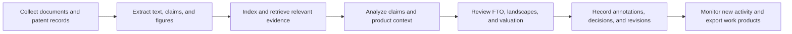
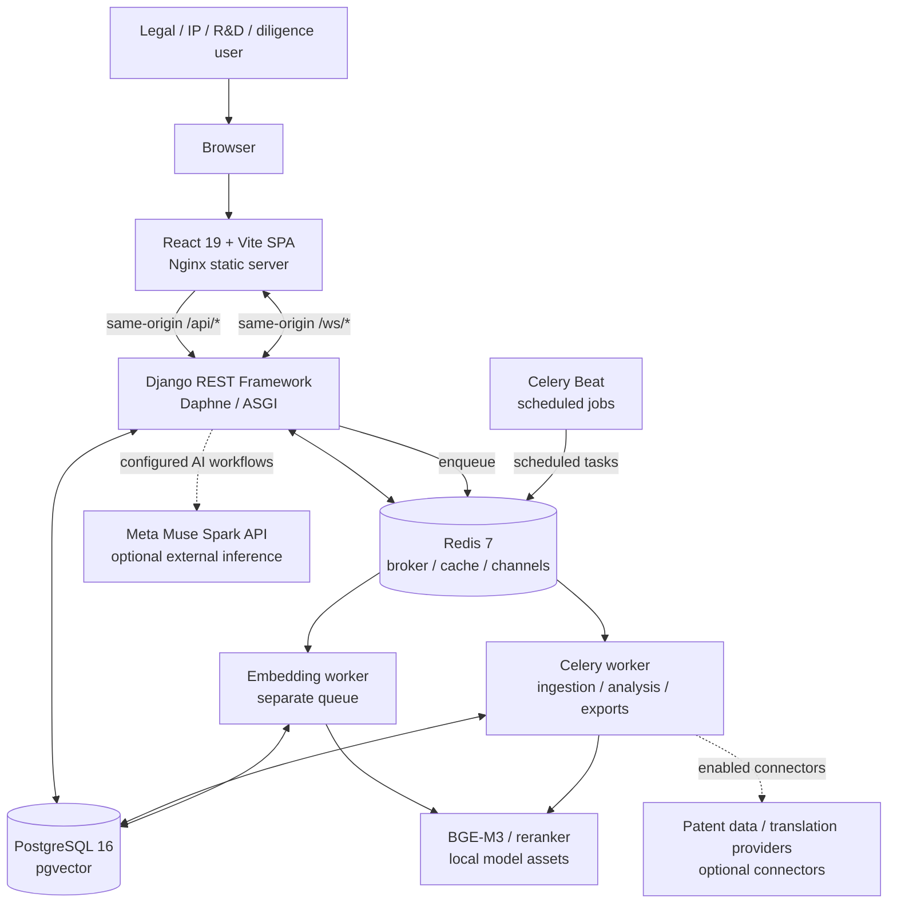

<div align="center">

# PatentShield

### Evidence Atlas · Enterprise IP Intelligence & Diligence Engine

**Turn patent documents, technical claims, and portfolio evidence into structured, reviewable intelligence.**

[](https://cerebralvalley.ai/e/meta-ai-developer-hackathon)
[](https://react.dev/)
[](https://www.djangoproject.com/)
[](https://www.postgresql.org/)
[](https://github.com/pgvector/pgvector)
[](#model-stack-at-a-glance)
[](https://www.docker.com/)
[](#license)

</div>

---

## Table of contents

- [Overview](#overview)
- [The problem](#the-problem)
- [The PatentShield approach](#the-patentshield-approach)
- [Product capabilities](#product-capabilities)
- [How the AI layer works](#how-the-ai-layer-works)
- [Architecture](#architecture)
- [Technology stack](#technology-stack)
- [Repository structure](#repository-structure)
- [Quickstart](#quickstart)
- [Configuration reference](#configuration-reference)
- [API reference](#api-reference)
- [Enterprise identity and governance](#enterprise-identity-and-governance)
- [Valuation scenario examples](#valuation-scenario-examples)
- [Testing and verification](#testing-and-verification)
- [Security, privacy, and responsible use](#security-privacy-and-responsible-use)
- [Deployment](#deployment)
- [Hackathon submission](#hackathon-submission)
- [Roadmap](#roadmap)
- [License](#license)
- [Acknowledgments](#acknowledgments)

---

## Overview

**PatentShield** is an enterprise-oriented intellectual property (IP) intelligence and diligence workspace for patent professionals, in-house legal teams, R&D organizations, technology companies, investors, and M&A engineering teams.

Patent diligence is rarely a single search. Teams need to collect source documents, understand technical disclosures, isolate independent claim limitations, compare products with patent claims, monitor relevant patent activity, and preserve the assumptions behind portfolio decisions. Those tasks are often spread across disconnected databases, PDFs, spreadsheets, and review workflows.

PatentShield brings those activities into one tenant-aware workspace. It combines patent document ingestion, multilingual retrieval, claim-centric analysis, competitor watchlists, Freedom-to-Operate (FTO) studies, technology landscapes, portfolio valuation scenarios, prosecution assistance, and enterprise identity controls.

The product is designed around an **evidence-first workflow**: source documents and publication records remain distinguishable from extracted data, retrieval results, model-generated analysis, user assumptions, and human review decisions.

> **Source-backed implementation note:** The uploaded repository implements a **React 19 + Vite frontend and Django REST Framework backend served through Daphne/ASGI**. It does not currently implement a Next.js frontend or FastAPI backend. The Meta AI client is configured for **Meta Muse Spark** by default through an OpenAI-compatible chat-completions interface; the uploaded source does not establish a Llama 3 deployment. This README documents the repository that is actually present rather than describing a different stack.

## The problem

IP and technical diligence teams face several recurring challenges:

- **Fragmented evidence:** Patent publications, uploaded PDFs, claims, legal events, product specifications, and diligence notes live in separate places.
- **Search limitations:** Exact keyword search can miss semantically related inventions, especially when patent material spans Chinese, Japanese, Korean, and English text.
- **Claim complexity:** Independent claims must be broken into limitations and compared with product features without losing the source context.
- **Monitoring overhead:** Tracking assignees, patent publications, legal events, and delivery follow-up can become a repetitive manual task.
- **Untraceable assumptions:** Portfolio estimates are difficult to review when revenue, royalty, discount, tax, comparable, and cost assumptions are not versioned with their evidence.
- **Enterprise governance:** Confidential IP work requires tenant boundaries, matter-level access, identity federation, session controls, and administrative auditability.

## The PatentShield approach

PatentShield turns the diligence process into a connected workflow:



The platform is intended to help teams move from document discovery to evidence-backed review. It is a decision-support system—not an autonomous legal decision-maker.

## Product capabilities

The following table describes capabilities represented in the uploaded source tree. Some workflows depend on provider credentials, locally available model artifacts, tenant policy, or external data-source configuration.

| Workspace | What it does | Implementation notes |
|---|---|---|
| **Patent library & ingestion** | Upload patent PDFs, manage document versions, inspect extracted claims, and track processing state. | Tenant-scoped patent and document-version records; asynchronous Celery extraction and indexing tasks. |
| **Semantic patent search** | Search technical material using dense retrieval and lexical ranking. | PostgreSQL `pgvector`, text chunks, BM25-oriented lexical search, and configurable embedding/reranking models. |
| **CJK / multilingual search** | Search Chinese, Japanese, and Korean patent text without requiring translation as the first step. | Unicode-script detection, CJK-aware character chunking and n-gram tokenization, multilingual `BAAI/bge-m3` configuration, and optional translation workflow. |
| **Meta-assisted patent analysis** | Generate patent-grounded answers, technology-landscape summaries, and preliminary claim-focused risk analysis. | Muse Spark client is optional and requires `META_LLM_API_KEY`, `META_LLM_BASE_URL`, and an enabled integration. |
| **Competitor surveillance** | Configure watchlists and rules, schedule polling, review generated alerts, and track notification delivery/retries. | Celery-backed polling and alert delivery. External surveillance/provider integrations are disabled by default and must be configured. |
| **Claim charts** | Create claim charts, edit limitation rows, maintain revisions, and export review artifacts. | Tenant-authorized chart, revision, and export endpoints. |
| **Freedom-to-Operate mapping** | Organize product matters and versions, extract or manage product features, compare features with patent limitations, attach evidence, and review a risk heatmap. | FTO candidate-matching and limitation-assessment workflows; candidate matching includes a versioned lexical-overlap algorithm, so human review remains essential. |
| **Technology landscapes** | Build landscape studies, select publications, analyze assignees and classifications, inspect clusters, annotate findings, and export studies. | `bge-m3`-oriented publication embeddings and a versioned clustering/projection workflow; IPC/CPC fields are available in publication metadata. |
| **Portfolio valuation & diligence** | Build a portfolio asset set, save diligence snapshots, compare valuation scenarios, attach assumptions, and retain immutable scenario revisions. | Income (relief-from-royalty), market-comparable, and cost/replacement-cost methodologies are implemented with bounded Decimal calculations. |
| **Office-action assistance** | Organize office actions and prosecution history, process source files, draft response material, and submit revisions for review. | Human review and approval remain part of the workflow. |
| **Enterprise administration** | Configure OIDC/SAML identity providers, SCIM 2.0 provisioning, managed sessions, matter policies/grants, and audit exports. | Enterprise identity APIs are under `/api/v1/enterprise-auth/`; deployment-specific identity-provider setup is required. |

### Frontend workspaces

The React application currently registers these primary routes:

| UI route | Workspace |
|---|---|
| `/dashboard` | IP workspace and analysis console |
| `/patents/search` | Patent library and search |
| `/patents/:id` | Patent detail, versions, claims, and evidence |
| `/search/multilingual` | CJK / multilingual search |
| `/surveillance` | Competitor surveillance |
| `/fto/analysis` | Freedom-to-Operate analysis |
| `/landscapes` | Patent landscape analytics |
| `/portfolio/valuation` | Portfolio valuation and diligence |
| `/office-actions` | Office-action and prosecution workspace |
| `/admin` | Enterprise administration |

> UI route names are not API endpoints. See [API reference](#api-reference) for backend URL prefixes.

### Document ingestion lifecycle

A newly uploaded patent is represented by a tenant-scoped `Patent` record and one or more immutable document versions. The patent-level state machine is:

```text
UPLOADED -> PROCESSING -> INDEXED
     \          \------> FAILED
      \----------------> FAILED
```

The associated document version tracks extraction separately from text and schematic indexing. The source defines extraction states such as `PENDING`, `EXTRACTING`, `EXTRACTED`, `OCR_REQUIRED`, and `EXTRACTION_FAILED`; indexing stages use `PENDING`, `PROCESSING`, `INDEXED`, `FAILED`, and `SKIPPED`.

At a high level, the worker pipeline:

1. Validates the uploaded PDF and its content digest.
2. Extracts page text and identifies OCR requirements.
3. Parses available patent claim structure into claim records.
4. Splits extracted text into source-offset-aware chunks.
5. Dispatches text and schematic indexing stages to Celery queues.
6. Persists stage state, retry information, and audit events.

The pipeline is asynchronous; an upload response does not mean the document is already searchable.

## How the AI layer works

PatentShield uses a combination of deterministic application logic, retrieval models, and a configurable generative model. These roles are deliberately separated so the generative LLM is not confused with the embedding or reranking models.

### Model stack at a glance

| Role | Model / technology | Purpose in PatentShield |
|---|---|---|
| **Primary generative LLM** | **Meta Muse Spark 1.3** | Generates patent-grounded answers, technology-landscape summaries, and preliminary claim-focused risk analysis through the Meta OpenAI-compatible chat-completions client. `Muse Spark 1.3` is the default model identifier in the checked-in Django settings; `META_LLM_MODEL` can override it. |
| Multilingual document embeddings | `BAAI/bge-m3` | Creates dense 1,024-dimensional embeddings for tenant-scoped patent document chunks, supporting multilingual semantic retrieval. |
| Public-patent embeddings | `BAAI/bge-large-en-v1.5` | Creates 1,024-dimensional embeddings for public patent publication records. |
| Cross-encoder reranking | `BAAI/bge-reranker-v2-m3` | Reranks retrieved query/document candidates to improve relevance after dense and lexical retrieval. |
| Lexical retrieval | BM25-oriented lexical search and CJK-aware tokenization | Complements vector retrieval with term-based matching, especially for scripts that do not use whitespace word boundaries. |

> **Important distinction:** Meta Muse Spark 1.3 is the project's configured **generative LLM**. BGE-M3, BGE-large, and BGE-reranker are supporting embedding/reranking models; they are not chat LLMs. The source code does not configure Llama 3 as the primary model.

The model names above describe the repository's configured defaults and implementation. Actual inference requires the corresponding model weights to be installed or reachable and, for Muse Spark, valid server-side API credentials and endpoint configuration. The source configuration alone does not prove that a live provider request has succeeded in a deployed environment.

### 1. Retrieval and multilingual representations

The indexing layer stores text chunks with tenant ownership, section metadata, language metadata, source offsets, embedding model identifiers, and vector representations. PostgreSQL with `pgvector` stores the vectors. The repository includes a multilingual BGE-M3 configuration (`BAAI/bge-m3`) and a multilingual reranker configuration (`BAAI/bge-reranker-v2-m3`). The lexical path includes CJK-aware tokenization so non-whitespace-delimited scripts can be searched without first translating the original text.

### 2. Meta Muse Spark reasoning — primary LLM

The backend contains an OpenAI-compatible `httpx` client (`MetaOpenAICompatibleClient`) in `backend/patents/ai_services.py`. Django settings in `backend/config/settings.py` define `META_LLM_MODEL` with the default identifier **`Muse Spark 1.3`**. The provider endpoint and model name are environment-configurable; this is not a Llama 3 integration.

The current patent-focused AI workflows are:

- **Landscape summarization:** produces an executive summary, technology themes, emerging trends, whitespace hypotheses, selected patent IDs, and evidence notes from supplied patent records.
- **Preliminary infringement-risk analysis:** compares a supplied invention description with a target patent, structures claim-element comparisons, highlights missing information, and normalizes a score into a preliminary `High`, `Medium`, or `Low` category.
- **Patent-grounded question answering:** answers using selected patent records and asks for additional source material when context is insufficient.

The service validates structured JSON responses, bounds the context passed to the model, filters landscape patent IDs against the supplied corpus, and avoids logging provider response bodies or credentials.

### 3. Configure the Meta integration

The integration is disabled unless configured. Add the following values to the backend environment:

| Variable | Purpose |
|---|---|
| `META_LLM_ENABLED` | Enables or disables Meta model calls. |
| `META_LLM_API_KEY` | Provider API credential. Keep it server-side. |
| `META_LLM_BASE_URL` | OpenAI-compatible API root; do not append `/chat/completions`. |
| `META_LLM_MODEL` | Model identifier. The source default is `Muse Spark 1.3`. |
| `META_LLM_TIMEOUT_SECONDS` | Request timeout. |
| `META_LLM_ALLOW_SENSITIVE_DATA` | Explicit policy gate for sending sensitive tenant data to an external model provider. |
| `PATENTSHIELD_META_LLM_CONTEXT_MAX_CHARS` | Maximum bounded context size supplied to the LLM workflow. |

Example configuration (replace all placeholders with authorized values):

```dotenv
META_LLM_ENABLED=True
META_LLM_API_KEY=<your-server-side-provider-key>
META_LLM_BASE_URL=<your-provider-openai-compatible-api-root>
META_LLM_MODEL=Muse Spark 1.3
META_LLM_TIMEOUT_SECONDS=60
META_LLM_ALLOW_SENSITIVE_DATA=False
PATENTSHIELD_META_LLM_CONTEXT_MAX_CHARS=60000
```

**Model naming matters:** this repository snapshot is configured for Muse Spark. Do not describe the checked-in implementation as a Llama 3 integration unless the provider/model configuration and actual model calls are changed and verified.

## Architecture

### System context



### Local Docker services

The local development Compose file defines seven services:

| Service | Responsibility | Local exposure |
|---|---|---|
| `postgres` | PostgreSQL with pgvector extension image | Internal Docker network |
| `redis` | Celery broker, cache, and Channels-related Redis endpoint | Internal Docker network |
| `api` | Django application served by Daphne / ASGI | `127.0.0.1:8000` |
| `worker` | Core background jobs, including ingestion and analysis queues | Internal Docker network |
| `embedding_worker` | Isolated embedding/indexing jobs | Internal Docker network |
| `beat` | Scheduled Celery jobs | Internal Docker network |
| `frontend` | React production build served by Nginx | `127.0.0.1:8080` |

The browser uses a same-origin API base in the Docker build. Nginx forwards:

- `/api/` to `http://api:8000/api/`
- `/ws/` to `http://api:8000/ws/`

This keeps browser requests on the frontend origin while preserving the internal Docker service boundary.

### Backend trust boundaries

- The browser authenticates with Django sessions and CSRF protection.
- Tenant-scoped requests identify the active tenant through `X-Tenant-ID`; this header is a selector, **not** an authorization credential.
- The backend independently checks active tenant membership and object-level permissions.
- WebSocket analysis progress is routed through Django Channels and tenant/matter authorization checks.
- Background work uses dedicated Celery queues; the embedding worker can run independently from general processing.
- External model and data-provider calls are optional and policy-controlled.

## Technology stack

| Layer | Technologies in the repository |
|---|---|
| Frontend | React 19, Vite, React Router, Zustand, Tailwind CSS, PDF.js, React-PDF |
| API / application | Python 3.12, Django 6.0, Django REST Framework |
| ASGI / real-time | Daphne, Django Channels, Channels Redis |
| Database | PostgreSQL 16, `pgvector`, psycopg |
| Background work | Celery, Redis, Celery Beat |
| Search / embeddings | BGE-M3 configuration, BGE reranker configuration, vector search, BM25-oriented lexical retrieval, CJK-aware tokenization |
| AI inference | Meta Muse Spark through a configurable OpenAI-compatible API client |
| Document handling | PyMuPDF, pypdf, Tesseract OCR, PDF.js / React-PDF |
| Enterprise identity | OIDC, SAML 2.0, SCIM 2.0, Django sessions, tenant roles, matter grants |
| Deployment | Docker, Docker Compose, Nginx, Helm, Kubernetes deployment templates, Kyverno policy examples |

## Repository structure

```text
.
├── backend/
│   ├── accounts/                 # Session login, logout, CSRF bootstrap
│   ├── analyses/                 # Analysis lifecycle, review, progress WebSockets
│   ├── audit/                    # Tenant-scoped audit events
│   ├── config/                   # Django settings, URLs, ASGI, Celery, health probes
│   ├── enterprise_identity/      # OIDC, SAML, SCIM, sessions, matter policies/grants
│   ├── fto/                      # Product matters, features, FTO studies, evidence
│   ├── indexing/                 # Chunking, lexical search, embeddings, vectors
│   ├── ingestion/                # Asynchronous PDF extraction pipeline
│   ├── landscapes/               # Landscape studies, clustering, analytics, exports
│   ├── multilingual_search/      # CJK search and optional translation
│   ├── office_actions/           # Prosecution records and response-draft workflows
│   ├── patents/                  # Patent records, AI, connectors, surveillance
│   ├── portfolio_valuation/      # Asset snapshots, valuation methods, revisions
│   ├── reports/                  # Reports, claim charts, export artifacts
│   ├── retrieval/                # Retrieval services and query orchestration
│   ├── tenants/                  # Tenant and membership models / access checks
│   └── tests/                    # Cross-module integration and release tests
├── deploy/
│   ├── airgap/                   # Offline image-import and runtime instructions
│   ├── helm/patentshield/        # Kubernetes Helm chart and templates
│   └── policies/kyverno/         # Deployment image policy examples
├── frontend/
│   ├── src/
│   │   ├── components/           # Product workspaces and screens
│   │   ├── hooks/                # Shared React hooks
│   │   ├── lib/                  # API client and shared utilities
│   │   └── stores/               # Zustand stores
│   ├── e2e/                      # Playwright end-to-end tests
│   ├── Dockerfile
│   └── nginx.conf
├── scripts/                      # Release and operational scripts
├── Dockerfile                    # Django / Celery backend image
├── docker-compose.local.yml      # Local source-build stack
├── docker-compose.yml             # Digest-pinned offline runtime
├── .env.example                   # Backend / Compose environment template
├── requirements.txt               # Hash-locked backend dependencies
├── requirements-dev.txt           # Development dependency lock
└── requirements-ml.txt            # Optional ML dependency lock
```

## Quickstart

### Prerequisites

For the Docker development stack:

- Git
- Docker Engine
- Docker Compose v2 (`docker compose`)
- Adequate memory and disk for PostgreSQL, Redis, Django, Celery, and model assets

For manual development:

- Python 3.12 (the backend image is based on Python 3.12)
- Node.js 22 (the local frontend Docker build uses Node 22)
- PostgreSQL 16 with the pgvector extension available
- Redis 7

Some ML-backed workflows require downloaded model weights or an installed model bundle. External AI, patent-data, translation, and surveillance workflows require their relevant provider configuration and are not assumed to be available in a fresh checkout.

### 1. Clone the repository

```bash
# Replace OWNER/REPOSITORY with your public GitHub owner and repository name.
git clone https://github.com/OWNER/REPOSITORY.git patentshield
cd patentshield
```

### 2. Create the environment file

```bash
cp .env.example .env
```

Generate unique local secrets:

```bash
python -c "import secrets; print(secrets.token_urlsafe(64))"  # Django secret
python -c "import secrets; print(secrets.token_urlsafe(32))"  # PostgreSQL password
```

Edit `.env` and set at minimum:

```dotenv
DJANGO_SECRET_KEY=<unique-random-secret-at-least-50-characters>
POSTGRES_DB=patentshield
POSTGRES_USER=patentshield
POSTGRES_PASSWORD=<unique-random-database-password>
```

If you use `DATABASE_URL`, keep its username, password, hostname, port, and database name synchronized with the PostgreSQL settings. Do not commit `.env`.

### 3. Build and start the local stack

Use the local Compose file. The root `docker-compose.yml` is a separate offline runtime that expects pre-imported, digest-pinned images; it is not the source-build development command.

```bash
docker compose -f docker-compose.local.yml up --build -d
```

Check service state and logs:

```bash
docker compose -f docker-compose.local.yml ps -a
docker compose -f docker-compose.local.yml logs --tail=100 api
docker compose -f docker-compose.local.yml logs --tail=100 frontend
```

### 4. Apply database migrations

```bash
docker compose -f docker-compose.local.yml exec api python manage.py migrate
```

Create an administrator account:

```bash
docker compose -f docker-compose.local.yml exec api python manage.py createsuperuser
```

### 5. Open PatentShield

| Service | URL |
|---|---|
| React application | <http://localhost:8080> |
| Django API | <http://localhost:8000> |
| Django admin | <http://localhost:8000/admin/> |
| Liveness probe | <http://localhost:8000/health/live/> |
| Readiness probe | <http://localhost:8000/health/ready/> |

The local Compose file binds published ports to `127.0.0.1` to avoid exposing the development services to the local network by default.

### Stop the stack

```bash
docker compose -f docker-compose.local.yml down
```

This preserves named database volumes. **Do not add `-v`** unless you intentionally want to delete local database and Redis data.

### Manual development setup

Manual setup assumes PostgreSQL and Redis are already running and reachable, and that the required environment variables are configured. The root `.env.example` documents the available settings.

**Backend terminal:**

```bash
cd backend
python -m venv .venv
source .venv/bin/activate          # Windows PowerShell: .venv\Scripts\Activate.ps1
python -m pip install --require-hashes -r ../requirements.txt
python manage.py migrate
python manage.py check
daphne -b 0.0.0.0 -p 8000 config.asgi:application
```

**Frontend terminal:**

```bash
cd frontend
cp .env.example .env              # Windows PowerShell: Copy-Item .env.example .env
npm ci
npm run dev
```

The frontend `.env.example` points the browser to `http://localhost:8000` for the API and WebSocket services. For a different backend origin, update `VITE_API_BASE_URL` and `VITE_WS_BASE_URL` before starting Vite. Variables prefixed with `VITE_` are bundled into browser assets; never put server secrets in the frontend environment.

## Configuration reference

The root `.env.example` is the configuration reference. The most important settings are grouped below; the example file includes additional connector, OCR, storage, and offline-deployment options.

| Category | Variables | Notes |
|---|---|---|
| Django | `DJANGO_SECRET_KEY`, `DJANGO_DEBUG`, `ALLOWED_HOSTS`, `LOG_LEVEL` | Use a unique high-entropy key. Production must disable debug and use explicit hosts. |
| Database | `POSTGRES_DB`, `POSTGRES_USER`, `POSTGRES_PASSWORD`, `DATABASE_URL`, `DB_CONN_MAX_AGE` | Keep connection details consistent. Use PostgreSQL with pgvector. |
| Redis / Celery | `REDIS_URL`, `REDIS_CACHE_URL`, `CELERY_BROKER_URL`, `CELERY_RESULT_BACKEND`, `CHANNELS_REDIS_URL` | Separate logical Redis databases are configured in the example. |
| Browser security | `CORS_ALLOWED_ORIGINS`, `CORS_ALLOW_ALL_ORIGINS`, `CSRF_TRUSTED_ORIGINS`, `SESSION_COOKIE_SAMESITE`, `CSRF_COOKIE_SAMESITE` | Match the real deployment origin. Do not weaken production CORS or CSRF policy. |
| Meta AI | `META_LLM_ENABLED`, `META_LLM_API_KEY`, `META_LLM_BASE_URL`, `META_LLM_MODEL`, `META_LLM_ALLOW_SENSITIVE_DATA` | Server-only provider configuration. Disabled by default in the example. |
| Embeddings | `BGE_MODEL_NAME`, `PATENTSHIELD_BGE_MODEL_REVISION`, `PATENTSHIELD_BGE_MODEL_PATH`, `PATENTSHIELD_MODEL_CACHE_DIR` | Pin model revisions and provision the correct model files for offline operation. |
| Reranking | `PATENTSHIELD_RERANKER_MODEL_NAME`, `PATENTSHIELD_RERANKER_MODEL_REVISION`, `PATENTSHIELD_RERANKER_MODEL_PATH` | Use a matching, pinned multilingual reranker bundle. |
| Patent connectors | `PATENTSHIELD_CONNECTOR_SYNC_ENABLED`, `USPTO_ODP_API_KEY`, `EPO_OPS_CLIENT_ID`, `EPO_OPS_CLIENT_SECRET` | Provider credentials and permissions are external prerequisites. |
| Surveillance | `PATENTSHIELD_SURVEILLANCE_ENABLED`, `PATENTSHIELD_SURVEILLANCE_ENCRYPTION_KEY`, `PATENTSHIELD_SURVEILLANCE_WEBHOOK_ALLOWED_HOSTS` | Disabled by default; webhook destinations are constrained by hostname allowlists. |
| Translation | `PATENTSHIELD_TRANSLATION_ENABLED`, `PATENTSHIELD_TRANSLATION_URL`, `PATENTSHIELD_TRANSLATION_API_KEY`, `PATENTSHIELD_TRANSLATION_ALLOWED_TENANTS` | Optional; enable only after privacy and provider review. |
| Enterprise identity | `PATENTSHIELD_ENTERPRISE_ENCRYPTION_KEY`, `PATENTSHIELD_IDP_ALLOWED_HOSTS`, `PATENTSHIELD_OIDC_CALLBACK_URL`, `PATENTSHIELD_SAML_ACS_BASE_URL` | Configure with your identity provider and public application URLs. |
| Storage | `PATENTSHIELD_STORAGE_BACKEND`, `AWS_STORAGE_BUCKET_NAME`, `AWS_S3_ENDPOINT_URL`, `PATENTSHIELD_OBJECT_STORAGE_KMS_KEY_ID` | S3-compatible storage is optional; credentials should come from a secret manager or workload identity. |

### Important environment rules

- Keep root `.env` and all populated secret files private.
- Do not place API keys in `frontend/.env` or any `VITE_*` variable.
- Keep the Django secret, database password, encryption keys, and provider credentials independent.
- Do not set `META_LLM_ALLOW_SENSITIVE_DATA=True` without explicit tenant/customer approval and an appropriate data-processing review.
- Keep external patent query disclosure disabled unless the tenant has authorized sending query text to the configured provider.
- For air-gapped environments, install and verify the model bundle before starting the runtime.

## API reference

The backend API is versioned under `/api/v1/`.

| Prefix | Purpose | Representative operations |
|---|---|---|
| `/api/v1/auth/` | Browser session authentication | CSRF bootstrap, login, current session, logout |
| `/api/v1/tenants/` | Tenant memberships | List the active user's tenant memberships |
| `/api/v1/patents/` | Patent records, search, AI, surveillance | Upload, semantic search, AI analysis, watchlists, alerts |
| `/api/v1/analyses/` | Analysis lifecycle | Create, inspect, retry, review, and track analysis progress |
| `/api/v1/reports/` | Reports and claim charts | Generate report artifacts, manage claim charts, revisions, exports |
| `/api/v1/office-actions/` | Prosecution workflows | Office-action records, processing, response drafts, review |
| `/api/v1/multilingual-search/` | Multilingual search | Search and request translation records |
| `/api/v1/fto/` | Freedom-to-Operate | Products, versions, features, studies, heatmaps, evidence, annotations |
| `/api/v1/landscapes/` | Technology landscapes | Publications, studies, clusters/analytics, assignees, annotations, export |
| `/api/v1/valuation/` | Portfolio valuation | Studies, assets, diligence snapshots, scenarios, revisions, annotations |
| `/api/v1/enterprise-auth/` | Enterprise identity and governance | OIDC, SAML, SCIM, matter grants, managed sessions, audit exports |

### Authentication flow

The browser client uses Django session cookies and CSRF protection rather than storing session credentials in `localStorage`.

```text
GET  /api/v1/auth/csrf/   -> set CSRF cookie and return csrfToken
POST /api/v1/auth/login/  -> establish authenticated session
GET  /api/v1/auth/me/     -> inspect current session
POST /api/v1/auth/logout/ -> revoke session and log out
```

Unsafe browser requests send the returned token in `X-CSRFToken` and include credentials. Tenant-scoped requests also send `X-Tenant-ID`; the backend verifies active membership and object access independently.

### Representative patent endpoints

```text
POST /api/v1/patents/upload/
GET  /api/v1/patents/semantic-search/
POST /api/v1/patents/ai/landscape-summary/
POST /api/v1/patents/ai/infringement-risk/
POST /api/v1/patents/ai/chat/

GET/POST /api/v1/patents/surveillance/watchlists/
GET/POST /api/v1/patents/surveillance/alerts/
```

Use the API source and serializers as the final contract for request bodies and response schemas. The endpoint list above is an orientation, not a substitute for the backend validation rules.

## Enterprise identity and governance

The enterprise identity module includes provider configuration and endpoints for:

- **OIDC:** identity-provider configuration, tenant/provider login initiation, and callback handling.
- **SAML 2.0:** login initiation, Assertion Consumer Service (ACS), and service-provider metadata endpoints.
- **SCIM 2.0:** service-provider configuration, resource types, schemas, user provisioning, and user deprovisioning/update routes.
- **Managed sessions:** list, revoke a session, or revoke all sessions for a user.
- **Matter-level authorization:** policies and grants scoped to a matter, with levels such as `READ`, `EDIT`, `REVIEW`, and `ADMIN` and subject roles such as `OWNER`, `ADMIN`, `ATTORNEY`, `ANALYST`, `REVIEWER`, and `READ_ONLY`.
- **Administrative audit export:** export supported audit records for compliance and operational review.

The enterprise API is rooted at `/api/v1/enterprise-auth/`. SCIM routes use the tenant-scoped `/scim/v2/<tenant_slug>/` path below that prefix.

Relevant configuration includes:

```dotenv
PATENTSHIELD_ENTERPRISE_ENCRYPTION_KEY=<deployment-managed-fernet-key>
PATENTSHIELD_IDP_ALLOWED_HOSTS=login.example.com,accounts.example.com
PATENTSHIELD_OIDC_CALLBACK_URL=https://patentshield.example.com/api/v1/enterprise-auth/oidc/callback/
PATENTSHIELD_SAML_ACS_BASE_URL=https://patentshield.example.com/api/v1/enterprise-auth/saml
PATENTSHIELD_SAML_METADATA_BASE_URL=https://patentshield.example.com/api/v1/enterprise-auth/saml
PATENTSHIELD_SCIM_MAX_PAGE_SIZE=100
```

Configure actual identity-provider issuer URLs, client identifiers, certificates, secrets, callback URLs, and SCIM tokens through the tenant administration workflow. Do not paste real credentials into this README or commit them to source control.

## Valuation scenario examples

Portfolio valuation scenarios are created under a valuation study. The current implementation supports three methods:

| Method | Meaning | Core input fields |
|---|---|---|
| `INCOME` | Relief-from-royalty discounted projection | `annual_revenue`, `royalty_rate`, `annual_revenue_growth_rate`, `discount_rate`, `tax_rate`, `projection_years`; optional terminal value inputs |
| `MARKET` | Weighted comparable transaction method | One to 50 sourced `comparables` with `label`, `transaction_value`, `weight`, `adjustment_rate`, and source evidence |
| `COST` | Replacement cost less obsolescence | `replacement_cost`, `obsolescence_rate`, optional `documented_additional_costs` |

### Create a valuation study

```http
POST /api/v1/valuation/studies/
Content-Type: application/json
```

```json
{
  "title": "Semiconductor IP portfolio diligence",
  "description": "Illustrative diligence workspace",
  "currency": "USD"
}
```

### Create an income-method scenario

```http
POST /api/v1/valuation/studies/{study_id}/scenarios/
Content-Type: application/json
```

```json
{
  "name": "Base case — relief from royalty",
  "description": "Illustrative scenario; validate all inputs with finance and IP reviewers.",
  "method": "INCOME",
  "currency": "USD",
  "assumptions": {
    "annual_revenue": "2500000",
    "royalty_rate": "0.04",
    "annual_revenue_growth_rate": "0.05",
    "discount_rate": "0.12",
    "tax_rate": "0.25",
    "projection_years": 5,
    "include_terminal_value": false,
    "basis_note": "Illustrative internal forecast; replace with an approved source."
  }
}
```

When `include_terminal_value` is `true`, provide `terminal_growth_rate`; it must be lower than `discount_rate`. In this API, the discount input is named `discount_rate`—not `wacc`. A user may document the rationale for the selected discount rate in `basis_note` or `source_reference`.

### Cost-method assumptions

```json
{
  "replacement_cost": "120000",
  "obsolescence_rate": "0.15",
  "documented_additional_costs": "5000",
  "basis_note": "Illustrative replacement-cost evidence; subject to reviewer validation."
}
```

### Market-method assumptions

```json
{
  "comparables": [
    {
      "label": "Comparable transaction A",
      "transaction_value": "950000",
      "weight": "1.0",
      "adjustment_rate": "0.05",
      "evidence_reference": "Deal memo / source record ID",
      "transaction_date": "2025-06-30",
      "notes": "Explain comparability and adjustments."
    }
  ],
  "basis_note": "Illustrative comparable set; verify transaction evidence."
}
```

Market comparables must include an evidence reference or a valid HTTPS source URL. The backend validates input types, numeric bounds, method-specific fields, currency consistency, and traceability notes. Scenario revisions are append-only and preserve the assumptions, calculated result, methodology version, and asset-manifest hash.

> Valuation outputs are assumption-driven indicated values—not independently verified market prices, investment advice, or guarantees of realizable value. The implementation returns present-value and scenario components; it should not be described as a certified valuation opinion.

## Testing and verification

The repository includes Django tests for API wiring, ingestion, retries, health checks, tenant isolation, WebSocket authorization, release configuration, performance contracts, and valuation calculations. The frontend includes ESLint, production build, and Playwright test configuration.

### Backend checks

Run inside the API container:

```bash
docker compose -f docker-compose.local.yml exec api python manage.py check
docker compose -f docker-compose.local.yml exec api python manage.py test
```

Run focused suites:

```bash
docker compose -f docker-compose.local.yml exec api python manage.py test portfolio_valuation
docker compose -f docker-compose.local.yml exec api python manage.py test tenants
```

### Frontend checks

```bash
cd frontend
npm ci
npm run lint
npm run build
```

### Browser tests

With the application available and the Playwright browser installed:

```bash
cd frontend
npx playwright install chromium
npm run test:e2e
```

### Runtime verification

```bash
# Service state
docker compose -f docker-compose.local.yml ps -a

# API and frontend logs
docker compose -f docker-compose.local.yml logs --tail=100 api
docker compose -f docker-compose.local.yml logs --tail=100 frontend

# Health and CSRF endpoints
curl -i http://127.0.0.1:8000/health/live/
curl -i http://127.0.0.1:8000/health/ready/
curl -i http://127.0.0.1:8000/api/v1/auth/csrf/
curl -i http://127.0.0.1:8080/api/v1/auth/csrf/
```

### Evidence and test-data guidance

- Use synthetic patent records and non-confidential sample PDFs for demonstrations and CI fixtures.
- Keep fixture documents small enough for predictable extraction and test runtime.
- Verify document state transitions and the separate extraction/text-indexing/schematic-indexing statuses.
- Verify tenant isolation with at least two tenants and users; a valid UUID in `X-Tenant-ID` must never bypass membership checks.
- Verify external provider integrations separately from unit tests. A mocked client or configured endpoint does not prove that a live third-party account is authorized.
- Record test commands and actual outcomes in release notes; do not claim an end-to-end workflow passed unless it was executed.

## Security, privacy, and responsible use

Patent disclosures, product roadmaps, and M&A diligence materials can be highly confidential. PatentShield includes controls intended to support safer handling, but each deployment still requires security review and operational ownership.

### Application controls in the source

- Tenant-scoped database models and tenant-aware query patterns.
- Active tenant membership checks on tenant-scoped requests.
- Matter-level policies and grants for fine-grained access.
- Django session authentication with CSRF protection and login throttling.
- Managed session registration and revocation workflows.
- Audit events for selected sensitive operations.
- Bounded PDF extraction and model context settings.
- Structured response validation and safe provider-error handling.
- Optional external disclosure controls for Meta inference, patent search, and translation.
- Allowlisted identity-provider and webhook hosts in relevant integration settings.

### Deployment responsibilities

Before exposing PatentShield to customers or confidential information:

1. Rotate any credential that has ever appeared in an archive, commit, terminal log, or screenshot.
2. Audit the complete Git history—not only the current working tree—for `.env` files, API keys, database passwords, and private documents.
3. Store production secrets in a secret manager or orchestrator-managed secret store.
4. Configure TLS, secure cookies, trusted CSRF origins, allowed hosts, CORS allowlists, and ingress limits for the real public origin.
5. Review tenant boundaries, matter grants, file access, backup/restore, retention, and audit export behavior.
6. Obtain tenant/customer authorization before sending confidential patent text, product details, or invention disclosures to any external model or data provider.
7. Review patent-data source terms, permitted use, attribution, rate limits, and jurisdictional coverage.
8. Apply security updates and scan container images, Python dependencies, frontend dependencies, and model artifacts.

### Legal and AI-use disclaimer

PatentShield generates research assistance and preliminary technical analysis. AI outputs, semantic similarity, candidate matches, FTO heatmaps, and landscape whitespace suggestions may be incomplete or incorrect. They are **not legal advice, a legal opinion, a claim-construction determination, or a conclusion that a product infringes or does not infringe a patent**. Qualified patent counsel and relevant technical experts must verify source documents, claim interpretation, jurisdiction, prosecution history, product facts, and legal status before relying on the output.

## Deployment

The repository provides two Docker Compose configurations and Kubernetes deployment assets.

### Local development

`docker-compose.local.yml` builds the backend and frontend from the source tree, starts PostgreSQL and Redis, and runs the API, two Celery workers, Celery Beat, and Nginx frontend.

### Offline / air-gapped runtime

The root `docker-compose.yml` is designed for an offline deployment workflow. It expects pre-imported, digest-pinned backend, frontend, PostgreSQL/pgvector, and Redis images; it uses `pull_policy: never`, mounts an installed model directory read-only, and disables selected outbound integrations in offline mode.

Review [`deploy/airgap/README.md`](deploy/airgap/README.md) before using this mode. It is not the same as the source-build local development stack.

### Kubernetes

The repository includes a Helm chart under [`deploy/helm/patentshield/`](deploy/helm/patentshield/) with deployment templates for the API, frontend, workers, ingress, storage, and network policy. Review the chart's `values.yaml`, `values.schema.json`, and the policy examples before deployment.

A deployment manifest is not, by itself, proof that an environment is production-ready. Production readiness depends on the configured infrastructure, secret handling, storage, backups, monitoring, incident response, security review, and end-to-end acceptance tests.

## Hackathon submission

**Event:** Meta Global AI Developer Hackathon  
**Project:** PatentShield — Evidence Atlas  
**Category / track:** Use the exact track selected in the official submission form.  
**Primary AI integration in this repository:** Meta Muse Spark through the configurable server-side LLM client.

### Suggested judging walkthrough

A concise product demo can follow this sequence:

1. **Problem:** show the fragmentation and complexity of patent diligence.
2. **Ingest:** upload a sample patent PDF and show its processing/indexing state.
3. **Discover:** search the patent workspace and run multilingual or semantic retrieval.
4. **Reason:** run a Muse Spark landscape summary, patent-grounded Q&A, or preliminary claim-risk workflow using non-confidential sample data.
5. **Map:** open an FTO study and show product features, claim limitations, evidence, and review status.
6. **Decide:** show a landscape or valuation scenario with source assumptions and revision history.
7. **Govern:** briefly demonstrate tenant context, matter access, or enterprise identity administration.

For a credible demo, use a small, curated corpus and make the source documents visible next to generated analysis. Clearly distinguish working features from provider integrations that are disabled or not configured in the demo environment.

## Roadmap

Potential next steps for the product include:

- Expand automated end-to-end tests across document ingestion, model-assisted analysis, surveillance delivery, FTO review, and identity-provider provisioning.
- Add richer evidence provenance and reviewer sign-off paths around AI-generated claim comparisons.
- Improve connector observability, provider licensing controls, and source freshness indicators.
- Add calibrated evaluation datasets for retrieval quality, multilingual recall, claim-element extraction, and hallucination resistance.
- Strengthen operational dashboards for queue health, model latency, indexing failures, and tenant-level usage.

These are roadmap directions, not claims that every item is complete in the current source snapshot.

## License

No root-level `LICENSE` file was present in the uploaded repository snapshot. Until a license is added by the project owner, the repository should be treated as **all rights reserved**; do not assume that public visibility grants permission to reuse, modify, or redistribute the code.

## Acknowledgments

PatentShield builds on the work of the open-source and provider ecosystems around:

- Meta AI and the Muse Spark model integration configured by the application.
- React, Vite, Tailwind CSS, and the PDF.js / React-PDF ecosystem.
- Django, Django REST Framework, Daphne, Channels, and Celery.
- PostgreSQL and the pgvector extension.
- BGE multilingual embedding and reranking models.
- PyMuPDF, pypdf, and Tesseract OCR.
- Docker, Nginx, Kubernetes, Helm, and Kyverno.

Please consult each upstream project's license and terms before redistributing its code, model weights, or associated assets.

---

<div align="center">

**PatentShield — Evidence Atlas for more searchable, explainable, and reviewable IP diligence.**

Built for the **Meta Global AI Developer Hackathon**.

</div>
